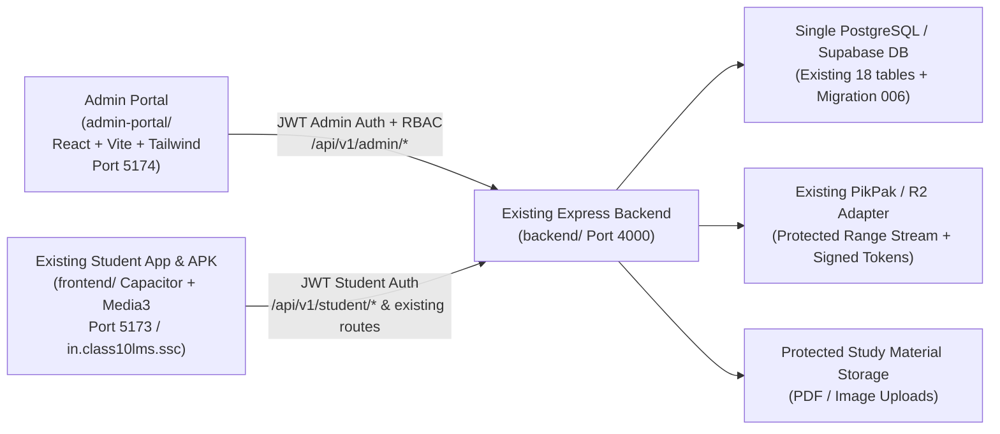

# Class 10 LMS Admin Portal — Phase 1 Existing System Analysis & Implementation Plan

## 1. Existing System Audit (Verified Against Source Code)

| # | Area | Verified Implementation in Workspace |
|---|---|---|
| 1 | **Android Application** | Capacitor 7 (`@capacitor/android` `7.0.1`), Package `in.class10lms.ssc` ([capacitor.config.json](file:///d:/Downloads/Android%20apk%20file/frontend/capacitor.config.json)), `MainActivity.kt`, native `Class10MediaPlayerPlugin.kt` + `LmsMedia3PlayerActivity.kt` (AndroidX Media3 ExoPlayer with `FLAG_SECURE`, dynamic student watermark, cinema overlay controls, debug loopback network security config). |
| 2 | **Student Frontend** | React `18.3.1` + Vite `6.1.0` + React Router `6.29.0` + Lucide React `0.475.0` ([frontend/package.json](file:///d:/Downloads/Android%20apk%20file/frontend/package.json)), custom responsive CSS ([app.css](file:///d:/Downloads/Android%20apk%20file/frontend/src/styles/app.css)), 10/10 Vitest passing. |
| 3 | **Backend API** | Node.js ESM (`>=20`, running `v22.23.2`) + Express `4.21.2` + Zod `3.24.2` + Helmet `8.0.0` + CORS + Compression + Rate Limiter + JWT `9.0.2` + Razorpay `2.9.6` + Supabase JS `2.49.1` ([backend/package.json](file:///d:/Downloads/Android%20apk%20file/backend/package.json)), DI factory `createApp()` ([app.js](file:///d:/Downloads/Android%20apk%20file/backend/src/app.js)), 17/17 Vitest passing. |
| 4 | **Database & Schema** | Supabase PostgreSQL with 5 migrations (`001_initial_schema.sql` through `005_video_provider_sync.sql`): 18 tables (`profiles`, `subscription_plans`, `subscriptions`, `payment_transactions`, `user_devices`, `user_sessions`, `subjects`, `chapters`, `lessons`, `lesson_video_sources`, `lesson_mcqs`, `mcq_attempts`, `lesson_notes`, `previous_exam_questions`, `important_formulas`, `lesson_progress`, `playback_audit_logs`, `security_events`), strict RLS in `002_rls_policies.sql`. |
| 5 | **Authentication** | Student auth via `AuthService` + `SupabaseAuthProvider` (prod) / `InMemoryAuthProvider` (dev/test), short-lived JWT access tokens (`15m`) + rotating refresh tokens (`7d`) bound to server-tracked `user_sessions` & hashed `user_devices` (`MAX_DEVICES_PER_STUDENT=1`), reuse-detection & concurrent session audit logging. |
| 6 | **Student Registration & Profile** | `POST /api/v1/auth/register`, `/login`, `/refresh`, `/logout`, `GET/PATCH /api/v1/auth/me`. `profiles` stores `id`, `full_name`, `email`, `phone`, `board ('AP'|'TS')`, `student_code`, `role`, `is_active`. Missing academic metadata (`school`, `district`, `medium`, `academic_year_id`, `account_status`, `last_active_at`) — to be added via additive migration `006`. |
| 7 | **Video Player & PikPak Integration** | Dual-engine `LMSVideoPlayer.jsx` + native Android Media3 `LmsMedia3PlayerActivity.kt`. Swappable `videoProviders/` (`pikpakLocalAdapter.js` for local testing + `cloudflareR2Adapter.js` for commercial launch). `VideoSyncService` auto-syncs PikPak folders (depth 4) into deterministic lesson UUIDs (`videoOrganisation.js`). |
| 8 | **Playback Authorization** | 7-step backend gate in `PlaybackService.authorizePlayback()`: JWT session -> active device -> active lesson -> active subscription + verified captured payment -> optional Play Integrity -> isolated `lesson_video_sources` lookup -> short-lived HMAC-SHA256 signed stream URL (`/api/v1/playback/stream/:streamToken`) with HTTP `200`/`206`/`416` byte-range streaming and zero upstream PikPak URL leakage. |
| 9 | **Notes & Resources** | `lesson_notes` (Markdown), `previous_exam_questions`, `important_formulas` served gated by subscription via `/api/v1/curriculum/notes|pyqs|formulas`. No PDF/file attachment upload or separate Telugu/English textbook medium yet — to be added cleanly in Migration `006` + `study_resources`. |
| 10 | **Quizzes & Exams** | Lesson-level MCQs exist in DB (`lesson_mcqs`, `mcq_attempts`), **HOWEVER** `frontend/src/pages/QuizPage.jsx` currently uses a hardcoded 15-question `CLASS10_QUIZ_BANK` array with client-side-only timer and `localStorage` scoring. Must be replaced with database-backed Quizzes & Exams with server-enforced timers. |
| 11 | **Progress Tracking** | Real lesson watch progress is stored in `lesson_progress` via `POST /api/v1/playback/progress`, **HOWEVER** `frontend/src/pages/ProgressPage.jsx` and `DashboardPage.jsx` currently show hardcoded subject percentage estimates (`48 + completedLessons * 8`, `72%`, `65%`, etc.) and static `Monthly SSC Practice Test (Oct 11, 2026)`. Must be computed live from the database. |
| 12 | **Hardcoded Student Frontend Audit** | Identified static items to replace in Phase 5: • `QuizPage.jsx`: `CLASS10_QUIZ_BANK` (15 hardcoded MCQs + client timer) • `ProgressPage.jsx`: hardcoded `subjectBars` + `localStorage` quiz bonus • `DashboardPage.jsx`: hardcoded `defaultPct`, static `Monthly SSC Practice Test` date, static badge `2`, static fallback title • `CoursesPage.jsx`: hardcoded `chaptersLabel` (`16 Chapters`, `14 Chapters`, etc.) • `SubscriptionPage.jsx`, `LessonPlayerPage.jsx`, `ProfileSettingsPage.jsx`: hardcoded `"₹499"` copy and static notification toast. |

---

## 2. Target Unified Architecture

### Non-Negotiable Preservation Guarantees
- **Zero breaking changes** to existing `/api/v1/auth/*`, `/api/v1/devices/*`, `/api/v1/subscriptions/*`, `/api/v1/payments/*`, `/api/v1/curriculum/*`, `/api/v1/playback/*`.
- **Single database & data store** (`SupabaseDataStore` + `InMemoryDataStore` parity for local preview & automated tests).
- **Separate Admin Auth & Backend RBAC**: Admins authenticate via `/api/v1/admin/auth/login` using scrypt salted hashes + server-tracked `admin_sessions` + `typ: 'admin_access'` JWTs. Every admin route enforces `requireAdmin` + `requirePermission(...)` + subject-scope checks on the backend. Student tokens are rejected with `403`.
- **Bilingual Video Strategy (`TE_EN_MIX`) vs Separate Textbook Medium (`EN`/`TE`/`BOTH`)**: Single PikPak/R2 video asset (`TE_EN_MIX`) maps to `['AP', 'TS']` without duplicating video files; existing raw filenames (`VID-20261108-WA0001.mp4`) can be mapped to clean display titles without modifying or deleting underlying storage files.
- **6-Stage Content Publishing Lifecycle**: `draft -> under_review -> approved -> scheduled -> published -> archived`. Student APIs only return `published` content matching the student's board (`AP` or `TS`). Unpublishing hides content from student listings while keeping all historical `lesson_progress`, `mcq_attempts`, `quiz_attempts`, and `admin_audit_logs` intact.

---

## 3. Phased Implementation Plan

1. **Phase 1 (Complete):** Codebase audit & architecture specification (`docs/ADMIN_PORTAL_ARCHITECTURE_AND_PLAN.md`).
2. **Phase 2 (Database & Backend):**
   - Additive SQL migration `supabase/migrations/006_admin_portal_cms.sql` (boards, academic_years, topics, study_resources, question_bank, quizzes, quiz_questions, quiz_attempts, exams, exam_sections, exam_attempts, notifications, notification_recipients, admin_users, roles, permissions, role_permissions, admin_sessions, admin_audit_logs, app_configurations + additive columns on existing tables + RLS policies).
   - Extend `InMemoryDataStore` (and `SupabaseDataStore` methods) + create modular backend services:
     - `adminAuthService.js` & `adminAuthMiddleware.js` (8 roles + full permission matrix + scrypt hashing + audit logging)
     - `adminCmsService.js` (Boards, Academic Years, Subjects, Chapters, Topics, Lessons, Drag-Drop Reorder, Publishing Workflow, Video Library + PikPak mapping, Protected PDF/Image Study Materials)
     - `assessmentService.js` (Question Bank with validation & CSV/Excel bulk import/export, Quizzes with server-enforced timer & random selection, Exams with objective auto-grading & descriptive manual evaluation)
     - `adminOperationsService.js` (Live Dashboard 16 KPIs + 10 real charts with filters, Student Management & 13-part profile, Progress Reports, Targeted Notifications, Dynamic Subscription Plans & Payment Ledger, Dynamic App Configuration, Admin Users/Roles, Audit Logs)
     - `studentDynamicService.js` (`/api/v1/student/home`, `/subjects`, `/chapters`, `/topics`, `/lessons`, `/resources`, `/quizzes`, `/exams`, `/progress`, `/notifications`, `/subscription`)
   - Wire routes in `backend/src/app.js` + seed default Super Admin & initial AP/TS boards/academic year/quizzes/exams in `dev-preview-server.js`.
3. **Phase 3 & 4 (Admin Portal Web App — `admin-portal/`):**
   - React + Vite + Tailwind CSS enterprise SaaS portal (`#155EEF` primary, `#F5F8FF` surface, `#172554` typography) with all 15 sidebar modules, global search, breadcrumbs, interactive charts, drag-and-drop lesson ordering, PikPak video mapper & protected preview player, PDF/notes uploader, Question Bank CSV/Excel bulk import/export, Quiz & Exam builders, Student 360° profile view, Notifications broadcaster, Subscription manager, Dynamic App Configurator, RBAC Manager, and Audit Log viewer.
4. **Phase 5 (Student App & Android APK Dynamic Integration):**
   - Connect `DashboardPage.jsx`, `CoursesPage.jsx`, `SubjectDetailPage.jsx`, `ChapterDetailPage.jsx`, `LessonPlayerPage.jsx`, `QuizPage.jsx`, `ProgressPage.jsx`, `SubscriptionPage.jsx`, `ProfileSettingsPage.jsx` to live `/api/v1/student/*` endpoints; remove all hardcoded educational content & hardcoded `₹499` strings.
5. **Phase 6 (Analytics, Notifications, Subscriptions & App Config Live Wiring):**
   - Verify dynamic App Config changes, Notifications delivery/read status, Plan pricing changes, and real-time progress reflection between Student App and Admin Portal.
6. **Phase 7 (End-to-End 12-Test Validation & Documentation):**
   - Automated Vitest E2E suite (`backend/tests/phase8_admin_portal_e2e.test.js`) executing all 12 Master Prompt tests + the full Section 28 Definition of Success workflow.
   - Verify all existing tests (17 backend + 10 frontend), production builds (`admin-portal`, `frontend`), live servers (`:4000`, `:5173`, `:5174`), and deliver complete API/DB/Deployment/Testing documentation.
