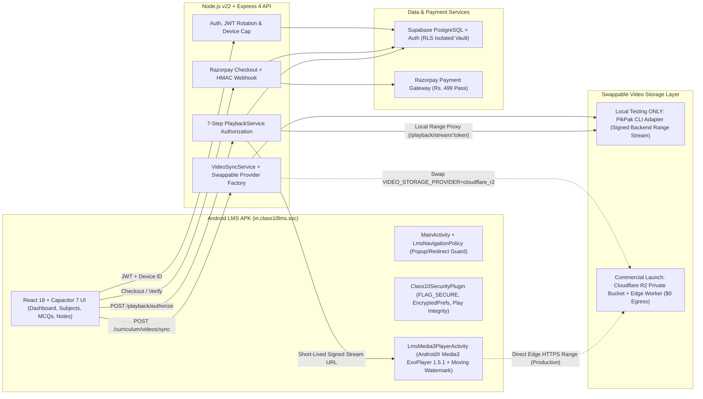

# Complete Project Report — Class 10 SSC LMS Android APK

**Project Name:** Class 10 SSC LMS (AP & Telangana State Board)  
**Android Package ID:** `in.class10lms.ssc` (Main LMS) • `in.class10lms.pikpakpoc` (Isolated Phase 4 PoC)  
**Workspace Root:** `d:\Downloads\Android apk file`  
**Report Date:** 2026-11-23  
**Project Status:** Core Full-Stack LMS, Native Android Media3 ExoPlayer, Swappable Video Sync Layer, Automated Test Suites, and Verified Debug APKs **Complete & Running Locally**; ready for live credentials (Supabase, Razorpay, Cloudflare R2) and Release APK signing.

> **Commercial Video Hosting Warning:** The local `pikpak_local` adapter is enabled strictly for **personal local testing** (auto-syncing your PikPak uploads to the Student Dashboard). Before onboarding paying students, flip `VIDEO_STORAGE_PROVIDER=cloudflare_r2` so video delivery runs legally at **\$0 egress** without PikPak's 3-device limit, 5 GB/day–1 TB/month CLI throttle, or non-commercial Terms of Service restriction.

---

## 1. Executive Summary

This project delivers a complete, security-hardened **Android LMS APK + Web App + Node.js API + Supabase PostgreSQL Backend** built for AP & Telangana Class 10 SSC students (₹499/year subscription model, 6 core subjects, chapter-wise video lessons, MCQs, revision notes, AP/TS PYQs, and formula sheets).

Across 7 engineering phases, the project accomplished:
1. **Production-Grade LMS Core:** Auth, JWT access/rotating refresh sessions, device-limit enforcement, concurrent login detection, Razorpay ₹499 checkout + HMAC verification + webhooks, Google Play Integrity verification, and a 7-step backend playback authorization gate.
2. **Database & Strict Row-Level Security (RLS):** 5 Supabase PostgreSQL migrations isolating `lesson_video_sources`, `payment_transactions`, `user_sessions`, and `lesson_mcqs` (correct answers never exposed before submission).
3. **WebView Navigation & Anti-Redirect Protection:** Native Kotlin `LmsNavigationPolicy.kt` + custom `BridgeWebViewClient` and `BridgeWebChromeClient` blocking external YouTube watch links, `youtu.be`, external browsers, app intents, and popups while keeping strict SSL validation (`handler.cancel()`).
4. **Own Branded Native Android Media3 ExoPlayer (`1.5.1`):** Integrated directly into the main LMS APK (`LmsMedia3PlayerActivity.kt` + `Class10MediaPlayerPlugin.kt`) and custom web HTML5 player (`LMSVideoPlayer.jsx`), eliminating YouTube branding and external redirects for uploaded videos—complete with `FLAG_SECURE`, dynamic moving student watermark, Play/Pause, -10s/+10s seek, SeekBar, `0.75x–2x` speed, landscape fullscreen with portrait snap-back, and progress resume sync.
5. **Swappable Video Sync Pipeline:** Automatic sync of uploaded videos from PikPak (`pikpak_local` for local personal testing) straight onto the **Student Dashboard** with a 1-tap **Sync Videos** button and a drop-in **Cloudflare R2** adapter (`cloudflare_r2`) for commercial scale.
6. **Deep Video Hosting Cost & Scalability Study:** Verified primary-source comparison of PikPak, Cloudflare R2, AWS S3 + CloudFront (Pay-As-You-Go & Flat-Rate), and YouTube Unlisted across 500, 1,000, and 5,000 students in USD & INR.
7. **Full Automated Verification & Verified APKs:** **16/16 backend tests** (including 200-concurrent-student load benchmark), **10/10 frontend tests**, **6/6 Android Kotlin JUnit tests**, **9/9 streaming proxy tests**, live Android 34 WHPX emulator playback, and signed debug APKs verified with `apksigner`.

---

## 2. End-to-End System Architecture

---

## 3. Complete Workspace Inventory

| Folder / File | Purpose | Key Files |
| :--- | :--- | :--- |
| **`backend/`** | Node.js v22 + Express 4 REST API, auth, payments, playback gate, swappable video providers, local preview server, Vitest suite | `backend/src/app.js`, `backend/src/server.js`, `backend/src/services/playbackService.js`, `backend/scripts/dev-preview-server.js` |
| **`backend/src/services/videoProviders/`** | Swappable video storage adapters (`pikpak_local` + `cloudflare_r2`) and sync service | `pikpakLocalAdapter.js`, `cloudflareR2Adapter.js`, `videoSyncService.js` |
| **`frontend/`** | React 18 + Vite 6 + Capacitor 7 student application, custom branded player, Dashboard sync UI, Vitest suite | `DashboardPage.jsx`, `LessonPlayerPage.jsx`, `LMSVideoPlayer.jsx`, `nativeBridge.js` |
| **`frontend/android/`** | Production Capacitor Android Kotlin project with Media3 ExoPlayer `1.5.1`, security plugins, navigation guard, and built APK | `MainActivity.kt`, `LmsMedia3PlayerActivity.kt`, `Class10MediaPlayerPlugin.kt`, `app/build/outputs/apk/debug/app-debug.apk` |
| **`supabase/migrations/`** | 5 SQL migrations covering core schema, strict RLS, AP/TS syllabus template, private stream provider, and swappable video sync | `001_initial_schema.sql` through `005_video_provider_sync.sql` |
| **`pikpak-poc/`** | Isolated technical PoC (auth diagnostics, localhost proxy, standalone ExoPlayer APK, and Phase 5 cost/scalability comparison) | `AUTH-DIAGNOSTIC-REPORT.md`, `PHASE-3-REPORT.md`, `PHASE-4-ANDROID-REPORT.md`, `PHASE-5-COST-COMPARISON.md` |
| **`docs/`** | Operational runbooks for env vars, Android release signing, testing, known limitations, and DRM roadmap | `ENVIRONMENT_VARIABLES.md`, `ANDROID_BUILD_AND_SIGNING.md`, `TESTING_REPORT.md`, `KNOWN_LIMITATIONS.md`, `FUTURE_DRM_MIGRATION_PLAN.md` |

---

## 4. Technical Stack & Component Details

### 4.1 Backend API (`backend/`)
- **Runtime & Packages:** Node.js `v22.23.2` (ESM), Express `^4.21.2`, Zod `^3.24.2`, Helmet `^8.0.0`, CORS `^2.8.5`, Compression `^1.8.0` (automatically bypassed for binary `/playback/stream/` responses), `express-rate-limit` `^7.5.0`, `jsonwebtoken` `^9.0.2`, `@supabase/supabase-js` `^2.49.1`, `razorpay` `^2.9.6`, `google-auth-library` `^9.15.1`.
- **API Route Groups (`/api/v1`):**
  - **Health:** `GET /health`
  - **Auth:** `POST /auth/register`, `POST /auth/login`, `POST /auth/refresh`, `POST /auth/logout`, `GET /auth/me`, `PATCH /auth/me`
  - **Devices:** `GET /devices`, `DELETE /devices/:deviceId`
  - **Subscriptions & Payments:** `GET /subscriptions/plans`, `GET /subscriptions/status`, `POST /payments/create-order`, `POST /payments/verify`, `POST /payments/webhook` (raw body HMAC verification)
  - **Curriculum & Video Sync:** `GET /curriculum/dashboard` (includes `syncedVideos` + `videoProvider`), `POST /curriculum/videos/sync`, `GET /curriculum/subjects`, `GET /curriculum/subjects/:id/chapters`, `GET /curriculum/chapters/:id/lessons`, `GET /curriculum/lessons/:id/mcqs`, `POST /curriculum/lessons/:id/mcqs/submit`, `GET /curriculum/notes`, `GET /curriculum/pyqs`, `GET /curriculum/formulas`
  - **Protected Playback:** `POST /playback/authorize` (7-step gate), `GET`/`HEAD /playback/stream/:streamToken` (timing-safe HMAC-SHA256 verified Range streaming), `POST /playback/progress`
  - **Play Integrity:** `POST /integrity/nonce`, `POST /integrity/verify`
- **Swappable Video Provider Layer:**
  - `pikpak_local`: Uses locally authenticated PikPak CLI `v0.6.0` (`.tools/pikpak.exe`) to recursively scan folders (root + `My Pack`), caches CDN URLs strictly in backend RAM, validates SSRF (`https://*.mypikpak.com` only), normalizes `Content-Type: video/mp4`, aborts upstream sockets on disconnect, and auto-recovers expired `401`/`403`/`410` URLs via CLI.
  - `cloudflare_r2`: Issues direct short-lived HMAC-SHA256 edge Worker URLs (`https://<R2_CUSTOM_DOMAIN>/<key>?exp=...&uid=...&dev=...&sig=...`) so video bytes bypass Node.js completely at **\$0 egress**.

### 4.2 Database Schema & RLS (`supabase/migrations/`)
- **`001_initial_schema.sql`:** `profiles`, `user_devices`, `user_sessions`, `security_events`, `subscription_plans` (`CLASS10_ANNUAL_499` = ₹499 / 365 days), `subscriptions`, `payment_transactions`, `subjects`, `chapters`, `lessons`, `lesson_video_sources`, `lesson_mcqs`, `mcq_attempts`, `lesson_notes`, `previous_exam_questions`, `important_formulas`, `lesson_progress`, `playback_audit_logs`.
- **`002_rls_policies.sql`:** Enables RLS across all tables; locks `lesson_video_sources`, `payment_transactions`, `user_sessions`, and `lesson_mcqs` strictly to backend service-role access so clients can never dump raw video sources or MCQ answer keys directly.
- **`003_seed_ap_ts_syllabus_template.sql`:** Seeds AP & Telangana Class 10 subjects (Mathematics, Physical Science, Biological Science, Social Studies, English, Telugu).
- **`004_private_stream_provider.sql` & `005_video_provider_sync.sql`:** Adds `stream_url`, `provider_file_id`, `file_name`, `mime_type`, and allows `pikpak_local`, `cloudflare_r2`, `private_stream`, `mux`, `cloudflare_stream`, and `drm_hls` providers.

### 4.3 Frontend Web & Capacitor App (`frontend/`)
- **Stack:** React `18.3.1`, Vite `6.4.6`, React Router `6.29.0`, Lucide React `0.475.0`, Capacitor `7.x` (`@capacitor/core`, `app`, `device`, `network`, `preferences`, `splash-screen`, `status-bar`).
- **Student Dashboard (`DashboardPage.jsx`):** Displays active ₹499 pass status, learning stats, **"Uploaded Video Lessons (Own Player)"** card list with a **Sync Videos** button (auto-discovering newly uploaded PikPak MP4s), and the 6-subject grid.
- **Own Branded Player (`LMSVideoPlayer.jsx`):**
  - For `pikpak_local`, `cloudflare_r2`, and `private_stream`: launches **Native Android Media3 ExoPlayer** automatically when running inside the Android APK, or renders the **custom branded HTML5 `<video>` LMS player** on web (Play/Pause, -10s/+10s, SeekBar, `0.75x–2x` speed, Fullscreen, moving student watermark, `controlsList="nodownload noplaybackrate"`, right-click disabled, zero YouTube logo/iframe).
  - Retains Official YouTube IFrame Player API only as a fallback for legacy `youtube_unlisted` records.

### 4.4 Native Android Layer (`frontend/android/`)
- **Build Toolchain:** OpenJDK `17.0.18`, Gradle `8.11.1`, AGP `8.7.2`, Kotlin `2.0.21`, `compileSdk 36`, `buildToolsVersion 35.0.0`, `minSdk 24`, `targetSdk 35`, AndroidX Media3 ExoPlayer `1.5.1`.
- **Native Modules Built:**
  - `LmsMedia3PlayerActivity.kt` — Hardware-accelerated Media3 ExoPlayer screen with `FLAG_SECURE`, dynamic 4-corner moving student watermark (every 12s), Play/Pause, -10s/+10s, `0.75x–2x` speed cycle, SeekBar, landscape fullscreen with portrait snap-back, retry error overlay, and watched-progress return intent.
  - `Class10MediaPlayerPlugin.kt` — Capacitor bridge plugin connecting React `LMSVideoPlayer.jsx` to `LmsMedia3PlayerActivity`.
  - `Class10SecurityPlugin.kt` — `FLAG_SECURE`, `EncryptedSharedPreferences`, Play Integrity token acquisition, and fullscreen orientation lock.
  - `MainActivity.kt` + `LmsNavigationPolicy.kt` — Intercepts WebView main-frame/subframe external links (`youtube.com/watch`, `youtu.be`, `intent://`, `market://`, external browsers), blocks `onCreateWindow()` popups, and cancels invalid SSL certificates (`handler.cancel()`).
  - **Network Security Split:** Release config (`src/main/res/xml/network_security_config.xml`) enforces strict HTTPS-only; Debug config (`src/debug/res/xml/network_security_config.xml`) allows cleartext exclusively on `127.0.0.1`, `10.0.2.2`, and `localhost`.

---

## 5. Video Hosting Feasibility & Cost Summary (Phase 5)

Assumptions: 500 original MP4 videos (30–60 min, **100 GB midpoint storage**), **1 Mbps** baseline (`0.45 GB/watch-hour`), **\$1 USD = ₹92.83 INR** (verified Nov 2026). Full 9-scenario breakdown and bitrate sensitivity (`1.0–4.0 Mbps`) are in `pikpak-poc/PHASE-5-COST-COMPARISON.md`.

| Provider | 500 Students (Med: 1.125 TB/mo) | 1,000 Students (Med: 2.25 TB/mo) | 5,000 Students (High: 22.5 TB/mo) | Media3 ExoPlayer? | Commercial Legal? | Verdict |
| :--- | :---: | :---: | :---: | :---: | :---: | :---: |
| **Cloudflare R2 + Worker** | **\$6.35 (~₹589)** *(direct: ₹125)* | **\$6.35 (~₹589)** | **\$6.35 (~₹589)** *(MP4)* / **\$12.50 (~₹1,160)** *(HLS)* | **Yes** | **Yes** | **RECOMMENDED** |
| **AWS S3 + CloudFront (Flat-Rate Pro)** | \$17.50 (~₹1,625) | \$17.50 (~₹1,625) | \$17.50 (~₹1,625) *(MP4 only; HLS hits 10M req cap -> \$202.50)* | **Yes** | **Yes** | Runner-Up |
| **AWS S3 + CloudFront (Pay-As-You-Go India)** | \$16.13 (~₹1,497) | \$138.75 (~₹12,880) | \$2,288.54 (~₹2,12,445) | **Yes** | **Yes** | Avoid (Egress Shock) |
| **YouTube Unlisted** | ₹0 | ₹0 | ₹0 | **No (Prohibited)** | **No / High Risk** | No Auth / No Media3 |
| **PikPak (Free / Premium)** | **FAIL** *(1 TB CLI cap)* | **FAIL** *(2.25× cap)* | **FAIL** *(22.5× cap)* | PoC Only | **No (Clause 2.3/8.1)** | Local Testing Only |

### Realistic Monthly INR Production Budget (Cloudflare R2 + Full LMS Stack, incl. ~21% GST/FX buffer)
- **Video Hosting Only:** **~₹720–₹800/mo** (500–1,000 students) • **~₹800–₹1,400/mo** (5,000 students, MP4 -> HLS).
- **All-In LMS Infra (Video + Node.js API + Supabase + Domain + GST/FX):** **₹1,620–₹5,150/mo** (500 students) • **₹5,070–₹6,120/mo** (1,000 students) • **₹6,730–₹11,790/mo** (5,000 students).

---

## 6. Complete Verification, Test & Build Results

| Suite / Verification Area | Result | Measured Evidence |
| :--- | :---: | :--- |
| **Backend Automated Suite (`backend && npm test`)** | **16 / 16 PASS** | 4 test files passed: auth/device caps (7), Razorpay/playback gate/curriculum (6), PikPak sync + HMAC Range stream + SSRF + R2 adapter (2), 200-student load benchmark (1 — 400 concurrent API calls, 100% succeeded). |
| **Frontend Automated Suite (`frontend && npm test`)** | **10 / 10 PASS** | 3 test files passed: learning/MCQs (2), `LMSVideoPlayer` YouTube + `private_stream` + `pikpak_local` Own LMS Player (6), auth lifecycle (2). |
| **Frontend Production Bundle (`vite build`)** | **PASS** | Built `dist/` cleanly (`1627` modules transformed, synced into Android `assets/public`). |
| **Android Kotlin JUnit (`:app:testDebugUnitTest`)** | **6 / 6 PASS** | `LmsNavigationPolicyTest` verified external YouTube/intent/popup blocking and embed preservation. |
| **Main LMS APK (`frontend/android/`)** | **VERIFIED** | `frontend/android/app/build/outputs/apk/debug/app-debug.apk` — **`8,455,522 bytes` (`8.06 MB`)**, `apksigner` v2 verified, installed & launched on live Android 34 emulator (`in.class10lms.ssc`). |
| **Isolated PikPak PoC Proxy (`pikpak-poc/`)** | **9 / 9 PASS** | Initial `206` (`230 ms`), `416`, 50% seek (`288 ms`), multi-Range (`128–137 ms`), disconnect abort (`activeStreams: 0`), `403` auto-recovery (`1,237 ms`), SSRF guard. |
| **Isolated PikPak PoC APK & Live Emulator** | **PASS** | `pikpak-poc/android-exo-poc/app/build/outputs/apk/debug/app-debug.apk` (`6.49 MB`); played `VID-20261108-WA0000.mp4` (`478x850`, `8.08s`) end-to-end (`0 -> 8082ms`), Pause/Resume, `+5s`/`-5s`, SeekBar, landscape fullscreen, error overlay, zero PikPak URLs in APK (`CLEAN_ZERO_MATCHES`). |
| **Live Main LMS Sync & Range Check** | **PASS** | Synced **2 live videos** from PikPak (`VID-20261108-WA0000.mp4`, `PikPak Tutorial.mkv`) onto Student Dashboard; authorized `provider=pikpak_local`, `youtubeVideoId=null`, `LEAKS_PIKPAK_URL=false`; streamed `HTTP 206` (`video/mp4`, valid MP4 `ftyp` header). |

---

## 7. Security Controls & Honest Limitations

### Implemented Security Controls
- **Zero Provider Secret Leakage:** PikPak CLI credentials, Supabase service role key, Razorpay secrets, and JWT secrets stay strictly server-side; binary APK scan confirmed zero embedded third-party tokens or signed PikPak URLs.
- **Short-Lived HMAC Stream Tokens:** `/api/v1/playback/stream/:streamToken` binds `(lessonId, fileId, userId, deviceId, exp)` with timing-safe HMAC-SHA256 verification (tampered or expired tokens return `HTTP 401`).
- **SSRF Protection:** Upstream fetches restricted strictly to `https://` + `mypikpak.com` / `*.mypikpak.com` (including redirects).
- **Android Hardening:** `FLAG_SECURE`, `EncryptedSharedPreferences`, Play Integrity support, moving student watermark, WebView popup/external navigation guard, strict SSL validation (`handler.cancel()`), release HTTPS-only network policy, `allowBackup="false"`.

### Known Limitations & Open Risks
1. **PikPak Non-Commercial Block:** `pikpak_local` must be swapped to `cloudflare_r2` before launching to paid students.
2. **Local Preview Store vs. Production Database:** `dev-preview-server.js` uses in-memory storage for local testing; production runs `npm start` (`backend/src/server.js`) backed by live Supabase PostgreSQL.
3. **No Hardware Widevine DRM Yet:** `FLAG_SECURE` + moving watermark + short-lived signed tokens deter casual piracy strongly, but cannot defeat rooted devices or external phone cameras (future HLS + Widevine path is documented in `docs/FUTURE_DRM_MIGRATION_PLAN.md`).
4. **Local Machine Disk Note (`C:` vs `D:`):** Because `C:` has `< 0.5 GB` free, Gradle caches, Android AVD, and temp directories are redirected to gitignored folders on `D:\Downloads\Android apk file\.*`.

---

## 8. Running Locally & Production Launch Checklist

### Local Development & Testing (Currently Running)
- **Backend Preview Server:** `node "d:\Downloads\Android apk file\backend\scripts\dev-preview-server.js"` (`http://localhost:4000/api/v1`, auto-syncs PikPak uploads).
- **Web Frontend Preview:** `http://127.0.0.1:5173` (`cd frontend && npm run dev -- --host 127.0.0.1 --port 5173`).
- **Android Emulator (`PikPakPocAvd`):** Main LMS APK `in.class10lms.ssc` installed with `adb reverse tcp:4000 tcp:4000`.
- **Sample Preview Accounts:** Paid student `paid@ap10.in` / `Password1234` • Expired student `expired@ts10.in` / `Password1234`.
- **Upload-to-Dashboard Workflow:** Upload any `.mp4` to your PikPak account -> tap **Sync Videos** on the Student Dashboard -> tap the video card to play inside your own Media3 ExoPlayer / custom web player.

### Checklist Before Commercial Launch (Real Paid Students)
1. **Provision Supabase Project:** Run migrations `001` through `005` in Supabase SQL Editor and populate `SUPABASE_URL`, `SUPABASE_ANON_KEY`, and `SUPABASE_SERVICE_ROLE_KEY` in `backend/.env`.
2. **Configure Razorpay Live Keys:** Add `RAZORPAY_KEY_ID`, `RAZORPAY_KEY_SECRET`, and `RAZORPAY_WEBHOOK_SECRET`, and point Razorpay webhook to `https://<your-api-domain>/api/v1/payments/webhook`.
3. **Switch Video Provider to Cloudflare R2:** Create private `APAC` R2 bucket + custom domain + HMAC-verifying Cloudflare Worker, encode lessons as `720p H.264 ~1 Mbps` with `-movflags +faststart`, and set `VIDEO_STORAGE_PROVIDER=cloudflare_r2`, `R2_CUSTOM_DOMAIN`, and `R2_SIGNING_SECRET` in `backend/.env`.
4. **Deploy Backend over HTTPS:** Deploy `backend/` (`npm start`) to Render / Railway / Mumbai VPS with `NODE_ENV=production` and strong 32+ char JWT/device secrets.
5. **Build Signed Release APK / AAB:** Set `VITE_API_BASE_URL=https://<your-api-domain>/api/v1`, create your release keystore (`keystore.properties`), run `npm run build && npx cap sync android`, and execute `:app:assembleRelease` / `:app:bundleRelease` (see `docs/ANDROID_BUILD_AND_SIGNING.md`).
