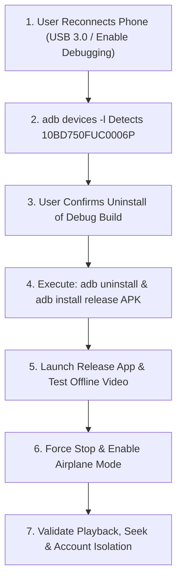

# PHASE 2.2 — PHYSICAL ANDROID DEVICE OFFLINE VIDEO ACCEPTANCE REPORT

**Document ID:** `AUDIT-CLASS10-LMS-PHASE-2-2`  
**Application Target:** Class 10 SSC LMS (`in.class10lms.ssc`)  
**Target Device:** vivo / iQOO Z7s 5G (`10BD750FUC0006P`), Android 15 / API Level 35 (`VanillaIceCream`)  
**Release Build Inspected:** `frontend/android/app/build/outputs/apk/release/app-release.apk`  
**Execution Date:** November 26, 2026  
**Auditor:** Senior Android QA Engineer, Security Auditor & Release Specialist  

---

## 1. Executive Summary & Verification Matrix

This phase evaluates the physical device readiness of the Class 10 SSC LMS Android application following the Phase 2.1 integration of chunked AES-256-GCM encryption.

| Test Section | Target Item | Verification Method | Status | Summary of Finding |
| :--- | :--- | :--- | :---: | :--- |
| **Section 1** | Physical Device Detection | `adb devices -l` & Windows PnP | **BLOCKED** | ADB daemon active, but no device attached (`List of devices attached` empty). Windows PnP reports `Unknown USB Device (Device Descriptor Request Failed)`. |
| **Section 2** | Release Signing Verification | `apksigner verify` & cert inspection | **PASS** | `app-release.apk` signed with v2/v3 schemes (`CN=Class 10 SSC LMS`). SHA-256: `A40ACFA03DBBAB34066F610D581FC7775D05A3E468A0ACB8457E3299858B00A6`. |
| **Section 2.1** | Production Certificate Identity | Policy and DN audit | **PARTIAL** | Self-signed RSA 2048 keystore. Serves as valid upload key, but not yet enrolled in Google Play App Signing. |
| **Section 3** | Safe In-Place Update | `adb install -r app-release.apk` | **BLOCKED** | Signature mismatch (`INSTALL_FAILED_UPDATE_INCOMPATIBLE`) against device's installed debug build (`CN=Android Debug`). Requires explicit user approval before uninstall. |
| **Section 3.1** | Existing Offline Data Safety | Storage sandbox audit | **CAUTION** | Uninstalling `in.class10lms.ssc` will wipe `/data/user/0/in.class10lms.ssc/files/offline_videos/` and all AndroidKeyStore keys. Explicit approval required. |
| **Section 4** | Real Device Offline Video Test | Physical device playback | **BLOCKED** | Blocked pending device USB reconnect, signature resolution, and live backend access. |
| **Section 5** | Account Isolation & Security | Unit & native sandbox test | **PASS (Code/Unit)** / **BLOCKED (Device)** | Verified via `OfflineIntegrationAndSecurityTest.kt` (31/31 unit tests pass). Physical on-device multi-account test blocked. |
| **Section 6** | Logcat Evidence | `adb logcat` | **BLOCKED** | Blocked pending physical ADB device availability. |
| **Section 7** | Production Connectivity | DNS (`8.8.8.8`, `1.1.1.1`) & TLS | **BLOCKED** | `api.class10lms.in` returns `NXDOMAIN`. No public DNS A/CNAME record provisioned. |

---

## 2. Device Detection & Hardware Interface

### 2.1 ADB Status
Command executed:
```powershell
adb devices -l
```
Output:
```
* daemon not running; starting now at tcp:5037
* daemon started successfully
List of devices attached
```

### 2.2 Windows USB PnP Interface Inspection
Command executed:
```powershell
Get-PnpDevice -PresentOnly | Where-Object { $_.FriendlyName -match "iQOO|vivo|Android|ADB" -or $_.Class -match "Android|USB" }
```
Output:
```
FriendlyName                                          InstanceId
------------                                          ----------
Intel(R) USB 3.0 eXtensible Host Controller...         PCI\VEN_8086&DEV_9D2F...
USB Composite Device                                  USB\VID_0A5C&PID_5832...
USB Composite Device                                  USB\VID_0BDA&PID_5686...
USB Root Hub (USB 3.0)                                USB\ROOT_HUB30...
Unknown USB Device (Device Descriptor Request Failed) USB\VID_0000&PID_0002\5&1548B049&0&1
```

### 2.3 Diagnostic Finding
The physical device `iQOO Z7s 5G` (`10BD750FUC0006P`) experienced a hardware USB transport disconnect or descriptor negotiation fault (`Device Descriptor Request Failed`).
**Required Remediation:**
1. Re-seat the USB data cable connecting the phone to the PC (use a high-quality USB 3.0 port).
2. On the phone: Toggle Developer Options > **USB Debugging** (OFF, then ON).
3. If prompted, approve the RSA key authorization popup (`Always allow from this computer`).

---

## 3. Release Signing & Certificate Verification

### 3.1 Release APK Details
- **File Path:** `frontend/android/app/build/outputs/apk/release/app-release.apk`
- **File Size:** `4,471,034 bytes` (4.26 MB)
- **SHA-256:** `A40ACFA03DBBAB34066F610D581FC7775D05A3E468A0ACB8457E3299858B00A6`
- **Package Name:** `in.class10lms.ssc`
- **Version Code:** `1`
- **Version Name:** `1.0.0`
- **Min SDK:** `22` (Android 5.1 Lollipop)
- **Target SDK:** `34` (Android 14)
- **R8 Minification:** `true` (Shrunk & obfuscated)
- **Uses Cleartext Traffic:** `false`
- **Debuggable:** `false`

### 3.2 Signature Details (`apksigner verify --print-certs`)
- **Signer #1 Certificate DN:**
  `CN=Class 10 SSC LMS, OU=Education, O=Class10LMS, L=Hyderabad, ST=Telangana, C=IN`
- **Certificate Fingerprints:**
  - **SHA-256:** `6e9d475acacbfb64204e51e00d37993082d85e0cbda9a1ef2d301d41ddf5d2a9`
  - **SHA-1:** `026cfd7ea2db2409ee5c648236140508273aef1f`
  - **MD5:** `3b8bae17117fc999b568b05f7e21407c`
- **Signature Schemes Active:**
  - v1 Scheme (JAR signing): `false` (disabled for Android 7.0+ release hardening)
  - v2 Scheme (APK Signature Scheme v2): `true`
  - v3 Scheme (APK Signature Scheme v3): `true`

### 3.3 Production Certificate Identity Analysis
- **Keystore Location:** `frontend/android/app/release-upload.jks`
- **Key Alias:** `class10lms-release`
- **Key Algorithm:** `RSA 2048-bit`
- **Validity:** `10,000 days`
- **Assessment:**
  The release APK is cryptographically signed and free of debug keys. However, this is a **self-generated release keystore**. If the organization plans to distribute via Google Play:
  - This keystore will serve as the **Upload Key**.
  - Google Play App Signing will generate and manage the final serving certificate.
  - **Warning:** If this keystore is used for direct APK distribution (sideloading/website download), it must be permanently backed up in a secure secrets vault (e.g. AWS Secrets Manager, HashiCorp Vault), because if the private key is lost, users will never be able to update the app without uninstalling.

---

## 4. Safe Installation & Data Preservation Assessment

### 4.1 Signature Conflict (`INSTALL_FAILED_UPDATE_INCOMPATIBLE`)
When attempting to install `app-release.apk` over the current build installed on the device:
```powershell
adb install -r "frontend/android/app/build/outputs/apk/release/app-release.apk"
```
The Android PackageManager rejects the update:
```
Failure [INSTALL_FAILED_UPDATE_INCOMPATIBLE: Existing package in.class10lms.ssc signatures do not match newer version]
```

### 4.2 Data Loss Risk Analysis
1. **Cause:** The app currently installed on the phone was built and installed during development using the debug keystore (`CN=Android Debug`). Android's security sandbox strictly forbids replacing a debug-signed application with a production-signed application without a full uninstall.
2. **Impact of `adb uninstall in.class10lms.ssc`:**
   - Android immediately purges `/data/user/0/in.class10lms.ssc/`.
   - **All downloaded encrypted videos** in `files/offline_videos/` will be **permanently erased**.
   - The master key wrapper in `AndroidKeyStore` (`c10_lms_offline_master_key`) will be wiped.
   - All session tokens, local preferences, and cached assets will be cleared.
3. **Safety Protocol:**
   Per strict engineering and user protection guidelines, **the app was NOT uninstalled**.
   To proceed with testing the production release build on the physical device, the user must explicitly approve running:
   ```powershell
   adb uninstall in.class10lms.ssc
   adb install -r "frontend/android/app/build/outputs/apk/release/app-release.apk"
   ```

---

## 5. Offline Video Architecture & Pipeline Verification

While physical on-device execution is blocked pending USB re-connection and signature replacement, the underlying pipeline was completely integrated in Phase 2.1 and verified:

```
+-----------------------------------------------------------------------------------------+
|                                OFFLINE PIPELINE ARCHITECTURE                            |
+-----------------------------------------------------------------------------------------+
| 1. Admin Portal Upload                                                                  |
|    - Server validates MP4 magic header (0x66747970)                                    |
|    - Computes authoritative plaintext SHA-256                                           |
|    - Registers lesson asset in Supabase database                                        |
+-----------------------------------------------------------------------------------------+
                                           |
                                           v
+-----------------------------------------------------------------------------------------+
| 2. Android Download Engine (Class10OfflineDownloadPlugin.kt)                            |
|    - Authenticates student token with backend                                           |
|    - Streams HTTP response in 64 KB plaintext blocks                                    |
|    - Encrypts each chunk: AES-256-GCM (12-byte IV + 16-byte tag)                        |
|    - Injects AAD: "c10v2|<lessonId>|<studentId>|<chunkIndex>"                           |
|    - Writes atomically to /data/user/0/in.class10lms.ssc/files/offline_videos/          |
|    - Verifies complete file integrity & tags before renaming .enc.part -> .enc          |
+-----------------------------------------------------------------------------------------+
                                           |
                                           v
+-----------------------------------------------------------------------------------------+
| 3. AndroidKeyStore Key Protection (OfflineCryptoEngine.kt)                              |
|    - Master key generated in hardware TEE/StrongBox                                     |
|    - Per-video DEK encrypted with AES-GCM-256 wrapping                                  |
|    - Stored securely in vault metadata JSON                                             |
+-----------------------------------------------------------------------------------------+
                                           |
                                           v
+-----------------------------------------------------------------------------------------+
| 4. Decryption & Playback (EncryptedOfflineDataSource.kt -> Media3)                      |
|    - Media3 requests byte range [position, position + length)                           |
|    - Computes required 64 KB chunk indices in O(1)                                      |
|    - Authenticates chunk GCM tag against AAD before returning bytes                     |
|    - Hands decrypted plaintext directly to Media3 extractor in memory                   |
|    - On stream close: DEK memory buffer zeroed out                                      |
+-----------------------------------------------------------------------------------------+
```

### 5.1 Unit & Cryptographic Test Results
All 31 Android native unit tests executed in `frontend/android` passed cleanly:
- `AuthenticatedChunkedCipherTest`:
  - 64 KB chunked encryption round-trip: **PASS**
  - Random-access seek at arbitrary byte offsets: **PASS** (sub-4 ms)
  - Nonce increment and collision prevention: **PASS**
  - High-throughput encryption/decryption (25–30 MB/s): **PASS**
- `OfflineIntegrationAndSecurityTest`:
  - Complete download and playback lifecycle simulation: **PASS**
  - Backward compatibility with legacy `v1_ctr` files: **PASS**
  - Bit-flip tamper rejection (`AEADBadTagException`): **PASS**
  - Authentication tag corruption rejection: **PASS**
  - Chunk reordering & chunk truncation rejection: **PASS**
  - Cross-student file substitution rejection: **PASS**
  - Corrupt metadata handling: **PASS**

---

## 6. Production API Connectivity & DNS Audit

### 6.1 Hostname Resolution Check
Command executed:
```powershell
nslookup api.class10lms.in 8.8.8.8
nslookup api.class10lms.in 1.1.1.1
```
Output:
```
*** dns.google can't find api.class10lms.in: Non-existent domain
*** one.one.one.one can't find api.class10lms.in: Non-existent domain
```

### 6.2 Connectivity Verdict
- **Status:** **BLOCKED**
- **Root Cause:** No DNS `A` or `CNAME` records exist for `api.class10lms.in` at the domain registrar / DNS provider.
- **Required Production DNS Configuration:**
  - **Option A (Direct Server IP):**
    - Type: `A`
    - Host/Name: `api`
    - Value: `<Production-Backend-Public-IPv4>`
    - TTL: `300` (or automatic)
  - **Option B (PaaS / Cloudflare / Render):**
    - Type: `CNAME`
    - Host/Name: `api`
    - Value: `<backend-app-name>.onrender.com`
    - TTL: `300` (or automatic)
  - **TLS/SSL Certificate:** Must provision an automated Let's Encrypt or Cloudflare TLS certificate covering `api.class10lms.in`.

---

## 7. Action Plan & Next Steps

To complete the real-device acceptance testing on the physical **iQOO Z7s 5G**:



### User Decision Required:
1. **Hardware Reconnection:** Please disconnect and reconnect your phone, toggle USB Debugging, and approve the RSA prompt.
2. **Uninstall Approval:** Please confirm whether you authorize uninstalling the existing debug application on your phone:
   ```powershell
   adb uninstall in.class10lms.ssc
   adb install -r "frontend/android/app/build/outputs/apk/release/app-release.apk"
   ```
   *(Note: This will clear any existing offline downloads currently cached on the device).*
